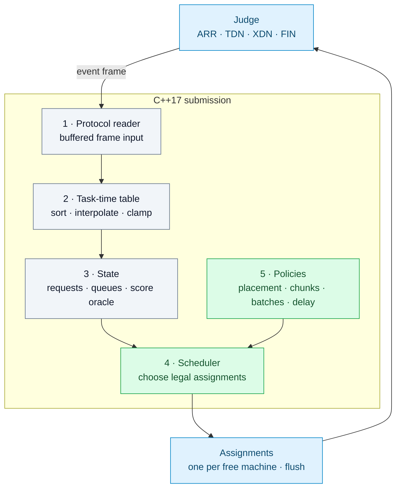

# ICPC 2026 AI Challenge: Edge–Cloud Collaborative Scheduling


Hi Everyone !!

This repository documents my solution to the **ICPC 2026 Online Challenge 1 powered
by Huawei** (Codeforces contest 2251, Problem A). It finished **56th worldwide
(top 1.3%)**. The preliminary leaderboard score was **16,147.866 / 22,000
(73.4%)** across 22 hidden interactive tests, with no protocol violations.

The archive includes the submitted solver, a local judge, test cases, verification
tools, decision logs, and post-contest research. The working tree also contains
research and tooling developed after the contest.

> New to heuristic programming? Start with
> [`docs/HEURISTIC_PROGRAMMING_EXPLAINED.md`](docs/HEURISTIC_PROGRAMMING_EXPLAINED.md) —
> what it is, in plain language with no coding background needed.

**Authorship:** The scheduling ideas, solver architecture, experimental direction,
and decisions documented here are mine — I (Ntokozo Dlamini). I used AI as an assistant to relay and
organize my instructions, help implement and check them, and prepare research
summaries under my direction. References to AI agents, advisors, or handoffs in historical files
describe that support work; they do not assign ownership of the solution's ideas.

- **Official problem statement:** <https://codeforces.com/contest/2251/problem/A>
- **Contest & official rankings:** <https://codeforces.com/contest/2251/standings>

---

## The problem

A single interactive C++ program drives an edge–cloud inference fabric: **one local
computer + K ≤ 8 identical clouds**, a shared bidirectional **FIFO transfer link**
(UP and DOWN independent), and up to **2,000 requests** whose output length _Lout_ is
hidden until completion.

Each request runs an input stage (prefill) and then _Lout_ output iterations; the solver chooses cloud assignment, prefill chunking, and
cross-cloud decode batching, one assignment per free machine per event frame, against
a **15 s / 256 MB** per-test budget and a **65,535-character single-file submission
limit** (up to 2·10⁶ frames per test).

```text
Score = 1000 · (w_tp · throughput_component + w_c · waiting_component)
```

- `throughput_component` — throughput (tokens/ms between first arrival and last token).
- `waiting_component` — versus two pooled-mean latency targets (TDR and TPOT), each test weighted differently.

See the
[official statement](https://codeforces.com/contest/2251/problem/A) and
[`research/scoring/`](research/scoring/) for the full, verified analysis.

## The solution

A single C++17 file (`src/submission.cpp`, auto-generated and minified from layered
sources by [`tools/merge_submission.py`](tools/merge_submission.py)), structured as
five layers:



The sealed contest artifact combines the following scheduling and runtime mechanisms:

| Mechanism                                       | Location                                                | Effect                                                                                                               |
| ----------------------------------------------- | ------------------------------------------------------- | -------------------------------------------------------------------------------------------------------------------- |
| Batch-size optimization using table breakpoints | `src/policies.cpp`                                      | Chooses a decode group size for each table shape, including non-monotone tables.                                     |
| Dynamic cross-cloud decode cap                  | `src/scheduler.cpp`                                     | Limits cross-cloud grouping when upload cost exceeds decode value.                                                   |
| Upload FIFO admission gate                      | `src/scheduler.cpp`                                     | Controls transfer queue depth using cloud count and SLO headroom.                                                    |
| Shortest-processing-time prefill order          | `src/scheduler.cpp`                                     | Reduces mean flow time; switches to an O(1) fallback after 1.2 million frames.                                       |
| Earliest-finish-time cloud balancing            | `src/policies.cpp`                                      | Distributes work to limit decode stragglers.                                                                         |
| SLO-aware decode accumulation                   | `src/policies.cpp`                                      | Delays a decode batch only when its estimated throughput benefit exceeds its latency cost.                           |
| Traffic-aware objective switch                  | `src/Solution.cpp`                                      | Prioritizes throughput when latency targets are provably unreachable.                                                |
| Live score oracle                               | `src/state.hpp`                                         | Prices projected score changes during scheduling; matches the judge to approximately 1e-10.                          |
| Allocation-free hot path                        | `src/state.hpp`, `src/protocol.cpp`, `src/Solution.cpp` | Uses intrusive ready lists and buffered I/O; measured at about 10.5 µs per frame in the stated worst-case benchmark. |

## Results

Preliminary leaderboard progression (22 hidden tests, feedback-only):

| Date      | Milestone                                                           | Score /22,000                |
| --------- | ------------------------------------------------------------------- | ---------------------------- |
| Aug 16    | First scored submission (reactive baseline + judge-accurate oracle) | 13,577.064                   |
| Aug 17    | SJF prefill ordering + TPOT-ratio batch cap                         | 14,778.987                   |
| Aug 18    | Leader-chain begin (transfer-aware assignment, equation stack)      | 15,590.128                   |
| Aug 18–19 | Equation stack: parallel-period caps, Oracle-exact marginals        | 16,032.93                    |
| Aug 20–21 | Theorem batches: hold physics, P_PRE gate, pick_local arbitration   | 16,147.866 (sealed)          |
| **Final** | **Official frozen standings**                                       | **#56 worldwide · top 1.3%** |

Full per-test judge protocols:

- [`docs/CF_JUDGEMENT_2026-08-16.md`](docs/CF_JUDGEMENT_2026-08-16.md)
- [`docs/CF_JUDGEMENT_2026-08-17.md`](docs/CF_JUDGEMENT_2026-08-17.md)

Reverse-engineered hidden-test parameter atlas:

- [`docs/HIDDEN_ATLAS.md`](docs/HIDDEN_ATLAS.md).

## Engineering and verification

**Decision log.** Every algorithmic choice — 160+ numbered entries D-001…D-162 — has
context, options, decision, evidence, and rollback:
[`docs/DECISIONS.md`](docs/DECISIONS.md).

No decision = no code.

**Verification battery** (all green before every promotion):

| Gate                                                          | Tool                               | Result                       |
| ------------------------------------------------------------- | ---------------------------------- | ---------------------------- |
| 74-case local suite (27 zoo + 47 adversarial)                 | `tools/interactor.py`              | 74/74 verdict ok             |
| Oracle agreement (solver projection vs judge)                 | `tools/interactor.py --oracle`     | 74/74, max \|Δ\| ≈ 4e-10     |
| Example-1 byte-identical replay                               | `tools/replay_pretest.py`          | PASS                         |
| Randomized crash sweep                                        | `tools/crash_sweep.py`             | 500/500                      |
| Protocol torture (pipe deadlock, float ghost, OOM)            | `tools/hostile_harness.py`         | ALL PASS                     |
| ASan / UBSan / DEBUG asserts                                  | `make san`, `make debug`           | clean                        |
| Metamorphic invariants (time-shift, determinism, permutation) | `tools/metamorphic.py`             | all pass                     |
| Statement-derived protocol fuzzing                            | `research/techniques/SB10_fuzz.py` | 10⁴ streams, zero violations |
| TLE proof: µs/frame × 2 M frames extrapolation                | `tools/scaling_bench.py`           | guard covers the worst case  |

**Ceiling analysis.** Recovered the scoring formula from the statement, audited the
judge against it (17/17), then proved **~4,900–5,200 of the 5,852 missing points are
structurally unreachable** — below link-bytes, cloud-ms, local-ms, and per-request
dependency resource floors (four bounds, 43 probe attacks).

Everything engineering went after the _contested_ pool instead.

See [`research/scoring/SYNTHESIS.md`](research/scoring/SYNTHESIS.md).

**Artifact engineering.** Single-file submission built by a custom merger/minifier
that strips dead `#ifdef` arms, renames long identifiers, and **hard-fails the build
if the result would exceed Codeforces' 65,535-character limit**. Final artifact:
65,522 chars (margin 13).

## Research program

Two ten-investigation programs ran alongside the contest (documents in
[`research/scoring/`](research/scoring/) and
[`research/techniques/`](research/techniques/)):

- **SA01–SA10 — scoring physics:** formula recovery and judge audit, throughput
  intervals, waiting-component calculus, admission value, aggregation losses,
  control-theoretic restatement, literature review, resource ceilings, and a
  line-level structural audit of the artifact.
- **SB01–SB10 — computation modules:** online scheduling theory, rollout/MPC design,
  an **exact forward simulator** (286 ns/event, Example-1 byte-identical), a
  **finite-difference-verified score calculus** (max rel err 2.9e-10 on 1,065 states),
  survival-conditioned Lout inference, exact batch/partition DP, lot-streaming and
  phase-offset pipelining, an endgame + binary-cliff controller (0 violations on
  300,000 adversarial trials), and artifact engineering (allocation-free hot path,
  governor, size machinery).

**71 research papers** (queueing, scheduling, LLM serving, survival analysis,
optimization) are archived under [`research/papers/`](research/papers/) with distilled
reading notes in [`research/notes/`](research/notes/).

A full **paper → code usage map** is in [`research/papers/USAGE.md`](research/papers/USAGE.md).

## Repository map

```
src/          Layered solver sources (protocol / task table / state / scheduler /
              policies) + generated single-file submission artifact
tools/        Local judge (interactor), case generators, verification harnesses,
              artifact merger/minifier
cases/        101-case corpus: 27 zoo + 47 adversarial + 21 CF-mimic + 6 perf
docs/         Decision log (D-001…D-162), judgement protocols, assumptions,
              hidden-test atlas, advisor reviews, optimization playbooks,
              plain-language heuristic guide
research/     Scoring-physics program (SA01–SA10), computation modules (SB01–SB10),
              71 papers + notes, experiments
Makefile      build / san / debug / submission (merger) / experiment targets
```

## Build and reproduce

```bash
make            # dev build (build/solution, full flags)
make submission # regenerate src/submission.cpp from layers (merger, 65,535 hard-fail)
make build/submission
make san        # ASan + UBSan
make debug      # asserts

python3 tools/replay_pretest.py build/submission     # official Example-1 replay: PASS
python3 tools/zoo_gate.py --solver build/submission  # 27/27
```

## Methodology

Development was directed by me (Ntokozo Dlamini) and AI-assisted, as permitted by the contest rules.

I originated the solution ideas, set the algorithmic direction, chose which
changes to pursue, and made the final decisions.

AI assisted to communicate, implement, research, and verify those choices under my direction.

Each implementation was tested against a verified local judge, compared with a snapshotted binary, and recorded
with evidence and a rollback plan.

Official judge feedback determined whether a scoring change was retained; every submission was analyzed per test.

## License

My original code and documentation are available under the [MIT License](LICENSE).
The archived third-party papers and quoted source material retain their own
copyright and license terms.

---

_Codeforces contest 2251 · ICPC 2026 Online Challenge 1 powered by Huawei. Problem
statement and rankings linked above._
