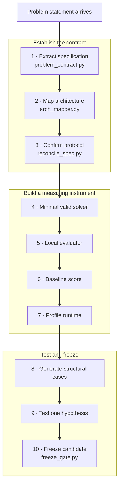

# 09 — Problem-Day Intake System

> **Historical note (post-contest).** I prepared everything except the problem-specific solver *before* Aug 14, then executed this intake when the Problem Set dropped. The competition ended Aug 28, 2026 — I finished **#56 worldwide with 16,147.866/22,000**. I (Ntokozo Dlamini) originated the intake design and decisions; AI sped up drafting and implementation under my direction.

**Purpose as executed:** everything except the problem-specific solver was prepared *before* Aug 14.
When the Problem Set dropped, the day's work was: I fed the statement into the intake
machine, got contract + architecture verdict + baseline + evaluator, then started the
discover-structure loop. The factory around the engine.

Statuses everywhere use the contract vocabulary: **CONFIRMED** (stated in official
spec), **OBSERVED** (measured), **ASSUMED** (chosen; must be reconciled), **UNKNOWN**
(legitimate — never silently upgrade a rule into an assumption; that is the entire
Day-10 Reality Layer lesson).

## The pipeline (Problem Day and after)



## 1. Problem Specification Extractor

`python3 tools/problem_contract.py --statement problem/statement.txt --out problem/`

- I saved the verbatim statement, regex-scanned it for evidence candidates, and emitted
  `problem/contract.yaml` + `problem/PROBLEM_CONTRACT.md` — every field started **UNKNOWN**.
- Hints were recorded as `hint:` notes; they never became facts. I edited the yaml
  to CONFIRM what the spec stated; everything else stayed UNKNOWN.
- `--check` validated statuses; a malformed contract exited 1.
- The contract fed `arch_mapper.py` and `freeze_gate.py`; the yaml was the single
  source of truth for protocol, scoring, runtime, and compliance assumptions.

Contract covers: identity, objective, input (format / N / T / streaming), output,
validity, scoring (per-case / aggregation / hidden distribution), evaluation
(per-test vs aggregate / re-generation / SPJ), runtime (CPU vs wall / limits),
submission (format / language / rate limits), hidden information, and compliance
(pre-developed technology, eligibility).

The generated schema also requires explicit fields for online visibility, output flushing,
SLO/failure semantics, resubmission and penalty policy, deterministic/stochastic judging,
process lifecycle/startup/output accounting, distinct submission and judging limits, and the
resource/capacity/edge-cloud communication model. `--check` rejects omitted or misspelled
schema fields and requires a value plus source for every CONFIRMED or OBSERVED fact.

## 2. Problem → Architecture Mapper

`python3 tools/arch_mapper.py --contract problem/contract.yaml`
`python3 tools/arch_mapper.py --dimension input_model --value streaming`

Classifies the problem on 12 dimensions (objective, input model, decisions,
feedback, state, horizon, contention, constraints, eval, score, interaction,
determinism) and compares against the **existing engine profile** (this repo's
engine: per-tick interactive streaming, online decisions, deadline-SLO
max-completion objective, hidden per-test eval).

The verdict answers the day-one question without a half-day debate:

> This resembles regime X → reuse architecture cautiously.
> Structurally unlike our engine → do NOT reuse blindly.

UNKNOWN dimensions are surfaced explicitly: assume nothing transfers.

## 3. Baseline in 60 Minutes

My first objective on Problem Day was **not the leaderboard** — it was a correct,
stupid, measurable baseline. No baseline = no measuring instrument = guessing.

1. **Contract extraction** (step 1) + protocol confirmation (`reconcile_spec.py`).
2. **Minimal valid solver**: stdin→stdout per the protocol, no intelligence.
   Correctness and I/O contract first; greedy policy second.
3. **Local evaluator**: `fast_judge.py` mirroring the protocol; as the real judge
   was interactive, the per-tick feeder was the evaluator.
4. **Baseline score** on official examples (I reproduced them) + a generated pool.
5. **Profiler**: I found the dominant cost. I did not optimize blind (EXP-31 rule:
   profile regions, not functions; rdtsc cumulative, not chrono).
6. **Case generator**: I ported `matrix_gen.py` cell parameters to the real problem's
   dimensions and verified each cell REPRODUCED its regime before reading results
   (regime-reproduction checkpoint, docs/DECISIONS.md).
7. **Structural analysis**: `case_classify.py` — "what is this case?"
8. **I optimized** via the differential harness.

## 4. Reusable matrix infrastructure

`python3 tools/case_classify.py 'cases/*/*.txt' --table`

The Day-10 matrix work became reusable: I classified any case file into cells by
structural pressure (n, T, arrival density, burstiness, deadline pressure rho,
contention, decode depth, COMM pressure, horizon pressure, scale).

This changed my optimization question from "which heuristic gives the biggest
score?" to "**where does my heuristic win, where does it lose, and what structural
condition causes the transition?**" — the regime question (generalization.md).

When the real problem arrived: I populated the matrix with the dimensions that mattered
for *that* problem, then evaluated every candidate per cell, not per total.

## 5. Differential experiment harness

Pieces already in the repo; used together they give attribution, not just deltas:

| Tool | Answered |
| ------ | --------- |
| `ab_test.py` | candidate vs baseline, same input/seed/evaluator/limits; valid & not-worse gate |
| `decompose_ab.py` | metric deltas per class (score/onT/lat95/slack/util) — what changed mechanically |
| `fail_mine.py` | failure-condition mining: which feature conjunctions caused regressions |
| `flip_lab.py` | per-flip admit-vs-refuse replay (causal flip set) |
| `case_classify.py` | affected cells |
| `opt_gap.py` | per-class optimality gap vs exact oracle (tiny) |
| `metamorphic.py` | time-shift neutrality, determinism, tie sensitivity |

Every experiment I ran answered: "+37 **because** these three structural
cells improved while this one regressed" — never just "+37".

## 6. Freeze gate (automatic)

`python3 tools/freeze_gate.py --candidate build/solution --baseline build/<frozen> \
  --build-command '<exact candidate build>' --san-source src/Solution.cpp \
  --san-flags='<exact candidate defines plus -DASSERT_STATE>'`

Use `--submission-ready` only when the Problem Set and organizer gates have been resolved.
It makes the complete actual contract, protocol reconciliation, and eligibility hard blockers.

```text
CANDIDATE FREEZE
================
Correctness             PASS     (protocol suite, no violations)
Protocol                PASS     (fast_judge valid)
Sanitizers              PASS     (declared candidate source/configuration + ASSERT suite)
Crash sweep             PASS     (crash_sweep.py --generate N)
Malformed input         PASS     (rehearsal.py)
Runtime                 PASS     (contest_runner vs limits.yaml, no TLE/RE/SIG)
Memory                  PASS     (no OOM under official limit)
Known cases             PASS     (suite + adversarial valid)
Regression pool         PASS     (ab_test vs baseline: valid and not worse)
Structural matrix       PASS     (per-cell ab_test: no class FAIL)
Score                   ______   (report; not a pass criterion by itself)
Margin                  ______   (runtime headroom vs warn/hard fractions)
Submission contract     CONFIRMED (reconcile_spec --check)
Eligibility             CONFIRMED (problem/contract.yaml go/no-go)
```

**A candidate does not become the winner merely because its score is bigger.**
A +1000-average / −200-on-an-important-regime candidate may lose to a +700 /
zero-regression one, depending on the hidden distribution. The gate enforces that
automatically: hard gates (validity, runtime, no class regression) block; score is
reported, never decisive alone.

## 7. Problem-Day checklist

I saved this as `problem/PROBLEM_DAY.md` on Aug 14 and ticked through it (all completed during the run to #56):

```text
PROBLEM DAY
[x] Save original statement/spec to problem/statement.txt (verbatim)
[x] Save official examples to problem/examples/
[x] Record timestamp + source URL
[x] Extract constraints  (problem_contract.py --statement)
[x] Extract scoring
[x] Extract submission protocol
[x] Mark UNKNOWN assumptions  (never silently assume; see contract)
[x] Resolve eligibility/submission questions (organizer Q1-Q12)
[x] Build minimal compliant solver (baseline in 60 min)
[x] Build local evaluator (fast_judge mirror)
[x] Reproduce official examples
[x] Build first baseline; record score
[x] Profile baseline; identify dominant cost
[x] Generate structural matrix (matrix_gen.py cells for THIS problem)
[x] Verify regime reproduction per cell (regime-reproduction checkpoint)
[x] Find first bottleneck
[x] Form ONE hypothesis
[x] Differential-test hypothesis (ab_test + decompose_ab + flip_lab)
[x] Regression gate (freeze_gate.py)
[x] Repeat
```

## Tool map (existing, reuse on Problem Day)

- **Contract/spec:** `tools/problem_contract.py`, `tools/arch_mapper.py`,
  `tools/reconcile_spec.py` (protocol/protocol.yaml = unknowns registry, `--blast`)
- **Baseline/eval:** `tools/fast_judge.py`, `tools/suite_gate.py`,
  `tools/contest_runner.py` (limits.yaml), `tools/rehearsal.py` (I/O lifecycle)
- **Cases/matrix:** `tools/case_gen.py` (families), `tools/matrix_gen.py`
  (structural cells, `--COMM`), `tools/case_classify.py` (cell assignment),
  `tools/stress_max.py` (degenerate zoo), `tools/adversarial_gen.py`
- **Experiments:** `tools/ab_test.py`, `tools/decompose_ab.py`, `tools/fail_mine.py`,
  `tools/flip_lab.py`, `tools/opt_gap.py`, `tools/metamorphic.py`,
  `tools/runtime_stress.py`, `tools/scaling_bench.py`, `tools/crash_sweep.py`
- **Freeze:** `tools/freeze_gate.py`
- **Docs:** `docs/05-strategy-playbook.md` (scheduler architecture once spec drops),
  `docs/08-validation-lab.md` (selection discipline), `research/day10/generalization.md`
  (matrix), `research/day10/clarifications.md` (organizer questions),
  `research/day10/workplan.md` (phases), `research/notes/experiments-log.md`
  (every experiment, EXP-NN), `research/notes/rejected-ideas.md` (reopen rules)

## Two go/no-go items (resolved before my competition-investment decisions)

1. **Eligibility**: age-of-majority/consent was UNKNOWN until the organizers clarified
   (clarifications.md Q1-Q3). I continued work as research/engineering regardless;
   submission strategy waited for clarification.
2. **Pre-developed technology**: Conditions ("not developed in substantive form
   before the Challenge") vs Rules ("may bring pre-developed Technology") — the
   existing frozen solver was NOT automatically submission-eligible. I did not spend
   the remaining days making it "submission-ready"; I prepared the factory instead.
