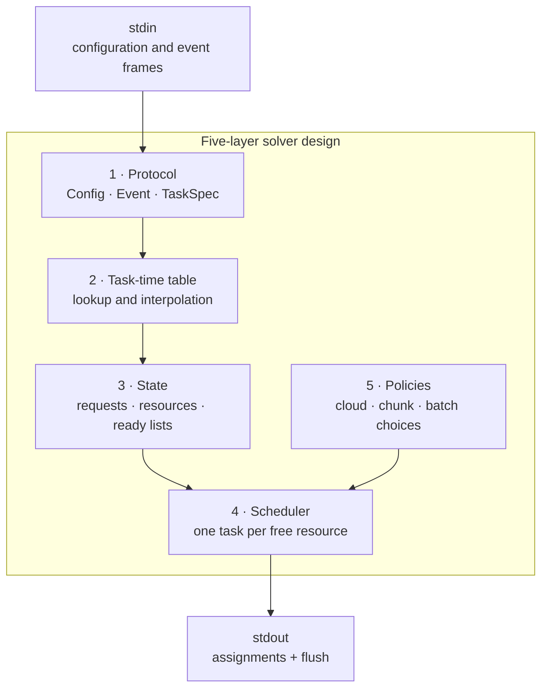
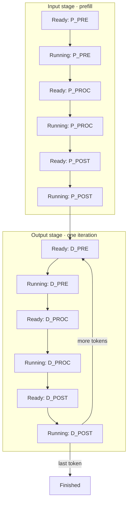

# ARCHITECTURE.md — Design Archive (Approved 2026-08-14, D-002; implemented for #56)

ICPC 2026 Online Challenge 1 powered by Huawei — Problem A "Edge–Cloud Collaborative Scheduling"

Scope: DESIGN ARCHIVE. Implementation was completed on my (Ntokozo Dlamini) go in Phase 4 and led to #56. Contest ended Aug 28 2026.

---

## 1. Overview

Five layers, as defined in this document.

Layers 1–4 were correctness-critical and were frozen early; only Layer 5 (policies) changed between candidates that led to #56.



## 2. File map (statuses reflect Aug 14 design time; all implementation was completed in Phase 4/5 and led to #56)

| File | Role | Status |
| --- | --- | --- |
| `src/protocol.hpp` | I/O: Config, Event, TaskSpec, ProtocolReader | DESIGNED, compiles clean |
| `src/task_table.hpp` | TaskTimeTable: sort + interpolate + clamp + skip -1 | DESIGNED |
| `src/state.hpp` | State machine: phases, ready lists, queues, stats | DESIGNED |
| `src/scheduler.hpp` | Decision engine interface | DESIGNED |
| `src/policies.hpp` | Strategy interfaces + V1 impls (LeastLoaded/OnePiece/SizeOne) | DESIGNED |
| `src/Solution.cpp` | Step-1 I/O skeleton (reads, prints 0, exits) | SKELETON ONLY |
| `src/*.cpp` (protocol.cpp, state.cpp, ...) | Definitions | NOT WRITTEN (Phase 4) |
| `build/submission.cpp` | Single-file merge (headers inlined) for Codeforces | GENERATED at submit time |
| `tools/merge_submission.py` | Inline headers → single file | Phase 5 |
| `tools/interactor.py` | Local judge: full protocol simulation + scoring | Phase 5 (design in TESTING_FORTRESS_DESIGN.md) |

## 3. Layer 1 — Protocol Reader (pure I/O)

- `Config`: K, S, latency_ms, bandwidth_gbps, bytes_per_token, num_layers + SLO1, SLO2, tp_UB, tp_base, dist_base, w_tp, w_c. Doubles read directly (9 decimals).

```text
transfer_time(cfg, len) = latency_ms + 8·len·bpt/(bw·10⁶)
```

- `Event`: kind; ARR(rid,lin); TDN(server=-1|k, spec tokens, dur); XDN(up, remote, size, pre, ids); FIN(rid).
- `TaskSpec`: the six legal task shapes; `parse()` from TDN echo or our output; `tokens()` canonical serialization.

  **TDN matching = canonical token equality against the resource's CurrentTask.spec** (single source of truth; robust to any echo normalization).
- `ProtocolReader::next_frame` returns false on `END` line or EOF → main exits 0 (never crash, never block).
- Handles e=0 frames; reads whole frame before returning (caller then responds once).

## 4. Layer 2 — TaskTimeTable

- `load(N, rows)`: store, sort by batch_size.

```text
get(step, batch_size) = exact / bracket / clamp with linear interp, skipping -1 rows
```

  Strictly positive guaranteed by statement.
- **Free oracle**: every TDN echoes the actual `dur` — debug builds assert `get_duration(step, size) == dur` (EPS) for every completed task. Catches any table bug for free.

## 5. Layer 3 — State

### 5.1 Request phases (13)



### 5.2 Event → transition table

| Event | Match | Effects |
| --- | --- | --- |
| ARR rid | none | create Request(lin, arrival=t), phase READY_P_PRE, push ready list |
| TDN E <spec> | local_.spec tokens == spec | free local; move the request: P_PRE→READY_P_PROC (input UP queued by interactor; our predicted UP pushed for planning), P_POST→READY_D_PRE + record ppost_t (stats), D_PRE→READY_D_PROC (UP per remote predicted), D_POST→ token stats, iter+1 → READY_D_PRE or (FIN beside) |
| TDN Ck <spec> | clouds_[k].spec == spec | free cloud k; P_PROC piece: advance next_ls; last piece → predicted DOWN push + READY_P_POST; else READY_P_PROC (next chunk issuable); D_PROC → READY_D_POST (predicted DOWN push) |
| XDN | — | input UP → READY_P_PROC (first chunk); input DOWN → READY_P_POST; DEC UP (per remote) → READY_D_PROC for those members; DEC DOWN → READY_D_POST for members; confirm() predicted queue head (debug) |
| FIN rid | — | phase FINISHED, finished=true, remove from ready lists, record stats |

### 5.3 Ready lists (incremental, O(events) total)
- Local-ready phases: READY_P_PRE, READY_P_POST, READY_D_PRE, READY_D_POST → 4 FIFO vectors.
- Cloud-ready: per cloud c: READY_P_PROC[c], READY_D_PROC[c] → 2 vectors per cloud.
- Requests move lists only on events/issue. Invariant (debug): each request in ≤1 list, only in a list iff its phase says ready.
- R ≤ 2000 → vectors of int ids; no per-frame O(R) scans anywhere.

### 5.4 Busy + prediction model

- On issue at t: resource busy, CurrentTask{spec,step,ids}; predicted busy_until = t + S + dur (planning only; ground truth = TDN).

```text
busy_until = t + S + dur
push(enter_t, dur) at issue-completion (t + S + dur)
confirm(t) at XDN (debug: head ≈ t)
```

- TransferQueue (UP/DOWN): FIFO of predicted finish times. Used by QueueAwareCloud (max(busy_until, up reach time)) and staggering policies.

### 5.5 Stats (offline scoring instrumentation)

sum_tdr, sum_span (Σ e_last−e_first), total_gaps, latest_token, earliest_arrival, tokens.

```text
Score = 1000·(w_tp·C_tp + w_c·C_w)
```

Enables exact recomputation on any recorded run (interactor also computes it independently).

## 6. Layer 4 — Scheduler (work-conserving)

- decide(state, t): for each free resource (local + each free cloud), pick the best legal task via policies; ≤ 1 per resource (n ≤ K+1). All assignments start at t.
- Local priority order (V1, correctness-first; ordering policies come later):

  1. READY_P_PRE (start input stages first — feeds everything)
  2. READY_P_POST (finish input stages; releases local; stops TDR)
  3. READY_D_PRE (next output iteration)
  4. READY_D_POST (produce tokens)

  (Within a list: FIFO; later: SPT-on-Lin, SLO-mean-aware ordering.)
- Cloud priority order: P_PROC pieces before D_PROC (V1; reorder later per score weights).
- Legality triple per task: resource free? all predecessors arrived? all members exactly at this step and not in flight/finished? (matching statement's three questions).
- In-flight guard: a request leaves its ready list on issue → cannot be double-issued.
- Work conservation is a heuristic, not a hard requirement (waiting allowed) — policies decide.

## 7. Assignment formatting (exact, from statement)

```
n                     (0 ≤ n ≤ K+1)
E P PRE <remote> <rid>
C<k> P PROC <ls> <le> <remote> <rid>
E P POST <remote> <rid>
E D PRE -1 <m> <rid...>
C<k> D PROC <remote> <m> <rid...>
E D POST -1 <m> <rid...>
```

One per line + flush. (Parser accepts arbitrary whitespace, but we print canonical.)

## 8. Performance budget (statement constraints)

- ≤ 2·10⁶ frames; R ≤ 2000; ΣLout ≤ 2·10⁵; K ≤ 8; num_layers ≤ 64; N ≤ 4096.
- State update: O(1) per event + O(m) for group XDN/TDN lists.

  Total ≈ O(frames + ΣLout·K) ≈ few M ops — safe.

- Decisions: per frame O(free resources · ready-list head ops). Ready lists are FIFO vectors; group building O(m). No quadratic anywhere.
- Memory: requests ≤ 2000 × ~200 B; events reused buffer. < 10 MB.
- I/O: sync_with_stdio(false), cin.tie(nullptr), '\n', flush after every response (mandatory).

## 9. Debug/validation discipline

- `#ifdef DEBUG`: check_invariants() after every frame; TDN-dur vs table oracle check; XDN vs predicted queue head check; ready-list membership check.
- Builds: `make` (-O2 -Werror, NDEBUG-ish via no-DEBUG), `make san` (ASan+UBSan), `make debug`.
- Submission = single merged file `build/submission.cpp` via `tools/merge_submission.py`; sha256 recorded in `build/PROVENANCE.json` (schema: source shas, merged sha, binary sha, flags, date, score history).
- Gates (Phase 5): zoo_gate, crash_sweep 3000, scaling_bench, sanitizer clean, rebuild identity, A/B via tools/ab_test.py.

## 10. V1 baseline definition (frozen candidate #1)

- Policies: LeastLoadedCloud + OnePieceChunk + SizeOneBatch (statement's suggested first solution).
- React only; predictions only fed cloud choice (busy_until).

  Everything completed; score target was achieved: non-zero on all 22 prelims; then I (Ntokozo Dlamini) A/B'd each policy axis (Step 5–8), which led to #56.
